# Umre Rehberim

Tur rehberi olmadan, bireysel olarak umreye gidenler için hazırlanmış mobil uygulama. Vize ve Nusuk randevularından tavaf sayacına, Harem'de kaybolmamaktan acil durumlara kadar yolculuğun her adımında yanınızda olur. İnternet olmadan da çalışır.

  <a href="https://umre-rehberim.pages.dev"><b>Uygulamayı aç</b></a> &nbsp;|&nbsp;
  <a href="https://umre-rehberim.pages.dev/umre-rehberim.apk"><b>Android APK'yı indir</b></a> &nbsp;|&nbsp;
  <a href="#telefona-kurulum">Telefona kurulum</a>

  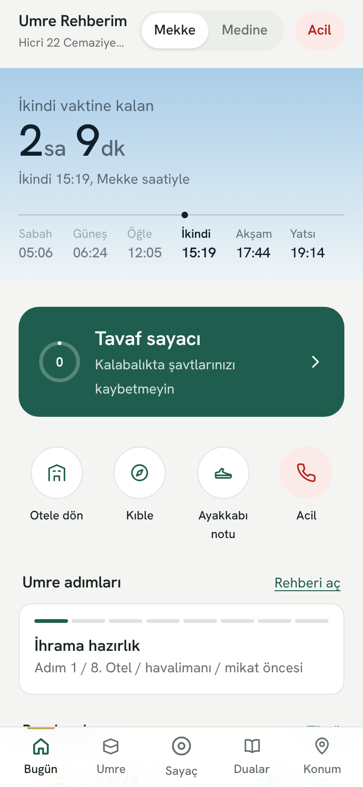
  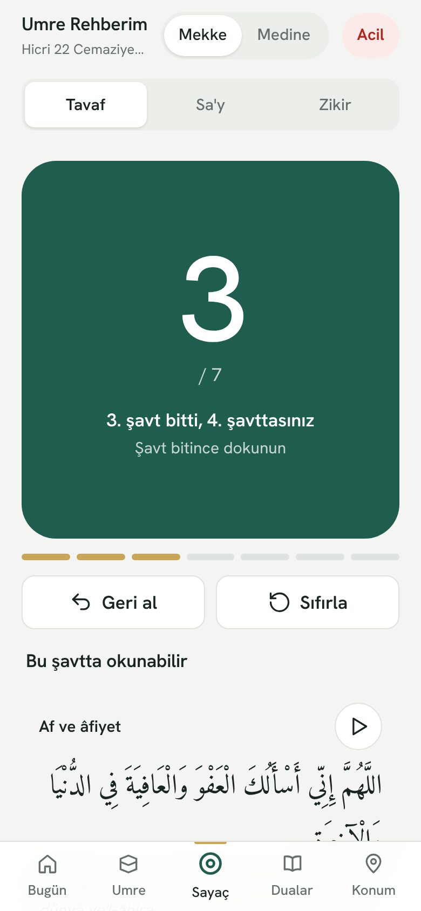
  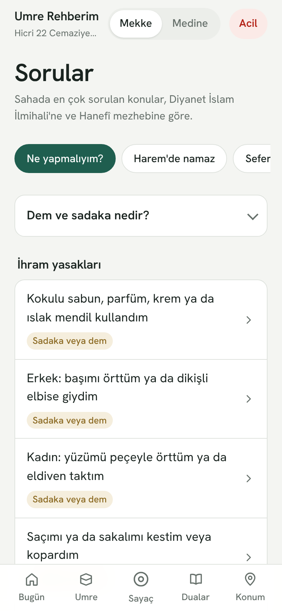

## Özellikler

### İbadet
- **Adım adım umre rehberi:** İhrama hazırlık, mikat, ihram yasakları, Harem'e giriş, tavaf, tavaf namazı, sa'y ve tıraş. Her adımda ilgili dualar ve tamamlama takibi. Kadınlara özel notlar.
- **Tavaf ve sa'y sayacı:** Ekranın yarısını kaplayan dokunma alanı, kalabalıkta yanlış saymayı önleyen "basılı tut" modu, her şavtta farklı titreşim ve o şavtın duası. Sa'yde yön (Safa'dan Merve'ye) gösterilir. Uygulama kapansa da sayı kaybolmaz. Android'de ses tuşlarıyla da sayar.
- **Dua kütüphanesi:** 29 dua, 7 kategori. Arapça metin, Türkçe okunuş ve anlam, arama, kaydetme, tam ekran gösterme ve internetsiz sesli dinleme.
- **Namaz vakitleri ve kıble:** Harem'deki ezanla aynı yöntemle (Ümmü'l-Kurâ) cihazda hesaplanır. Ana ekrandaki gökyüzü o anki vakte göre renk değiştirir. Pusula ile kıble yönü ve Kâbe'ye uzaklık.

### Sorular
- **Ne yapmalıyım?:** 22 durum için ne gerektiği ve ne yapılacağı: kokulu sabun kullanmak, tavafta abdestin bozulması, şavt sayısını unutmak, mikatı ihramsız geçmek gibi. Diyanet İslam İlmihali'ne ve Hanefî mezhebine göre hazırlandı.
- **Harem'de namaz:** Cenaze namazının kılınışı ve Hanbelî imama uyarken bilinmesi gerekenler.
- **Seferilik hesaplayıcı:** Kalınacak gün sayısına göre namazların kısaltılıp kısaltılmayacağı.
- **Başkası adına umre:** Kurallar ve niyet metni.

### Harem'de ve şehirde
- **Konum ve yön:** Otele, Harem kapılarına, sağlık noktalarına ve kaydettiğiniz noktalara pusulayla yön. İnternetsiz çevre haritası. Otelin Harem'e uzaklığı ve yürüme süresi.
- **Canlı aile haritası:** Davet bağlantısıyla grup kurulur, herkes birbirini haritada canlı görür. Konumlar telefonda şifrelenir. "Kapıda buluşalım" çağrısı gruptaki herkesin telefonunu titretir.
- **Ayakkabım nerede?:** Kapı ve raf numarası, fotoğraf ve konumla kayıt.
- **Geri dönüş izi:** Yürüdüğünüz yolu kaydeder, aynı yoldan başlangıca götürür.
- **Tabela sözlüğü:** Harem'deki 40 Arapça tabela ve Arapça rakam çevirici.
- **İhramlıyken nereden girerim?:** Mataf, katlar ve ana kapılar.
- **Tavaf için sakin saatler:** Günün namaz vakitlerine göre tahmin.
- **Ziyaret yerleri:** Mekke'de 6, Medine'de 5 yer: tarihçe, ziyaret adabı, ulaşım ve sesli anlatım.

### Yolculuk ve planlama
- **Vize ve Nusuk:** Adım adım vize rehberi ve resmî bağlantılar. Nusuk onay metni yapıştırılınca randevu otomatik okunur (Türkçe, İngilizce, Arapça). Geri sayım, takvime ekleme ve hatırlatma.
- **Uçuşta mikat uyarısı:** Uçak modunda da çalışan GPS ile mikat sınırına 30 ve 10 dakika kala titreşimle uyarır.
- **Gün gün plan:** Mekke ve Medine'de kalınacak günlere göre öneri planı.
- **Taksi kartı:** Gidilecek yer büyük Arapça yazıyla şoföre gösterilir.
- **Ulaşım:** Haramain hızlı treni, şehir otobüsleri, taksi ve yürüyüş bilgileri.
- **Kontrol listeleri:** Yola çıkmadan önce 35 maddelik hazırlık listesi ve dönüş öncesi liste.
- **Riyal çevirici:** Riyal, TL ve dolar arasında internetsiz çevirme.

### Güvenlik ve sağlık
- **Acil durum:** 911, 997, Hac ve Umre Bakanlığı, T.C. Cidde Başkonsolosluğu ve hastaneler. 14 acil Arapça cümle tam ekranda gösterilir. Türkçe-Arapça sağlık kartı.
- **Su ve sıcak:** Su sayacı, hatırlatıcı ve sıcak çarpması belirtileri.

### Kullanım kolaylığı
- **İnternetsiz çalışır:** Dualar, sayaç, vakitler, kıble, harita şeması ve kayıtlar internet olmadan da çalışır. Yazı tipleri uygulamaya gömülüdür.
- **Güneş modu** güneş altında en yüksek kontrastı verir. **Tasarruf modu** siyah zemin ve seyrek GPS ile pili korur. Dört yazı boyutu seçeneği var.
- **Her ekrana uyumlu:** Telefonda alt menü, tablette geniş düzen, bilgisayarda sol kenar menüsü.
- **Gizlilik:** Kayıtlarınız yalnızca kendi cihazınızda saklanır. Hesap açmak gerekmez.

## Ekran görüntüleri

| Ana ekran (akşam) | Umre rehberi | Dualar |
|---|---|---|
| 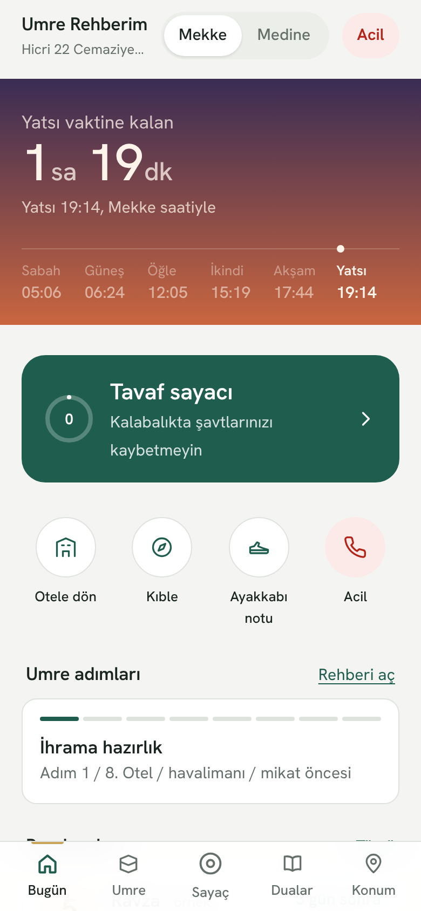 | 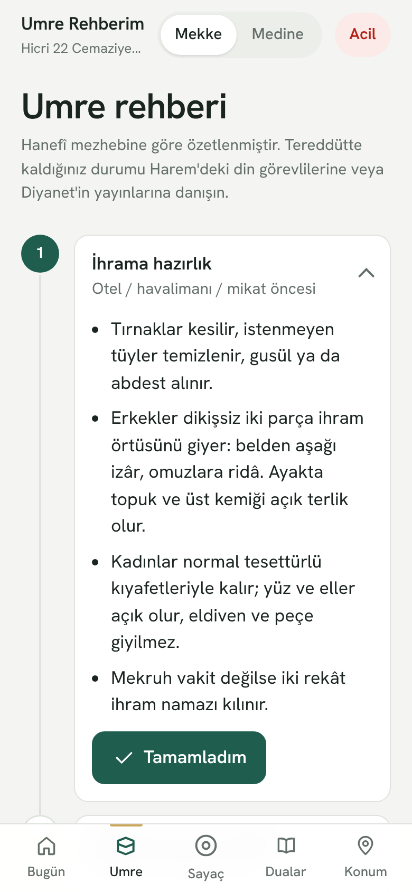 | 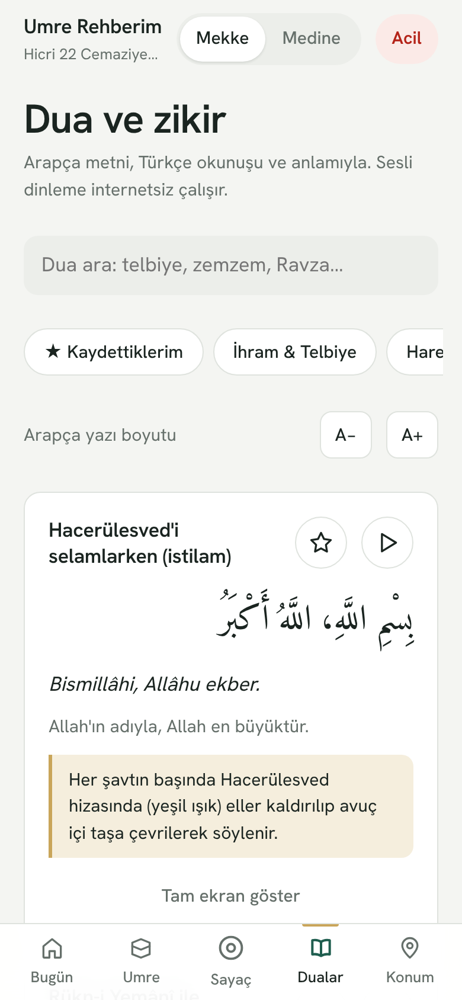 |

| Kıble pusulası | Araçlar | Uçuşta mikat uyarısı |
|---|---|---|
| 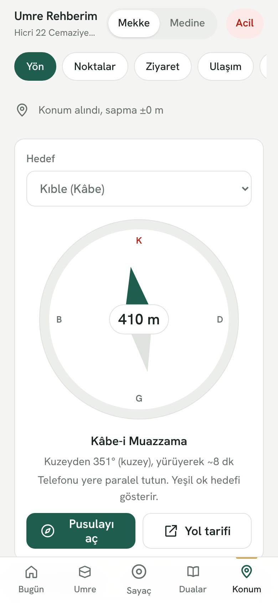 | 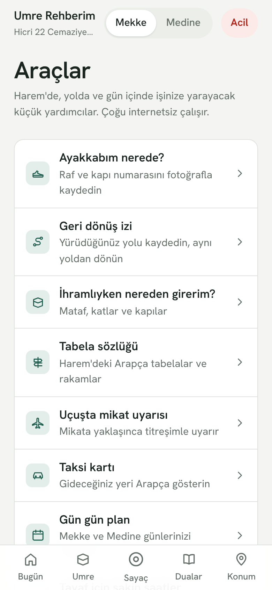 | 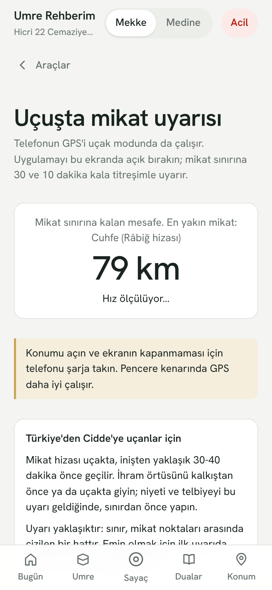 |

| Ayakkabı notu | Canlı aile haritası | Acil durum |
|---|---|---|
| 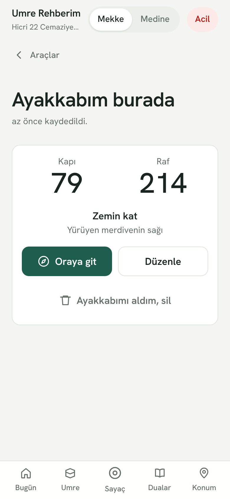 | 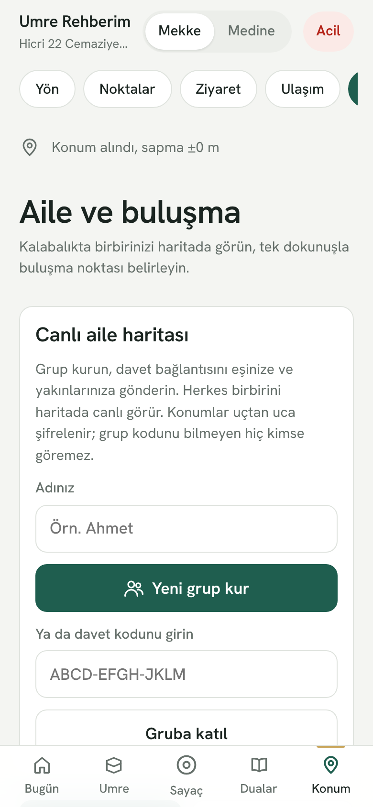 | 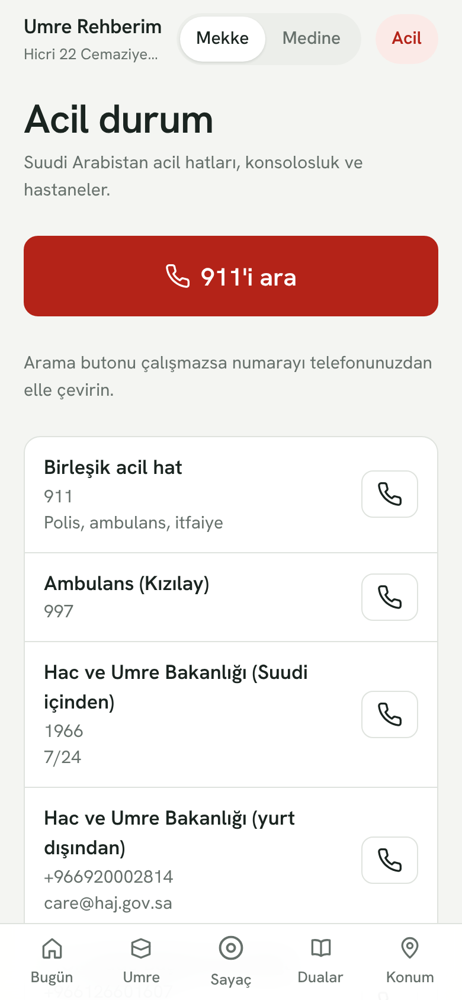 |

**Bilgisayar ve tablet**

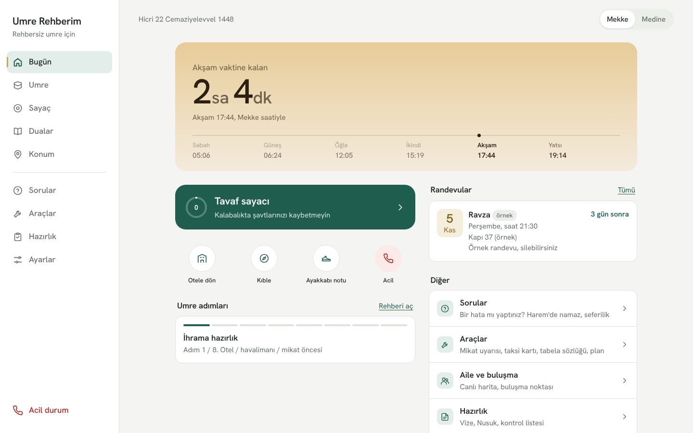

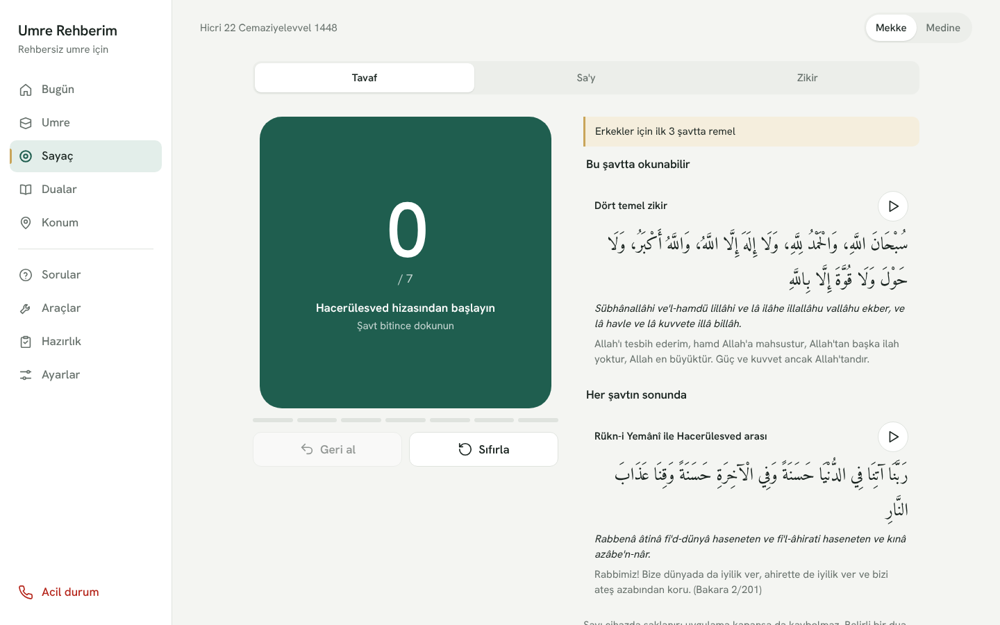

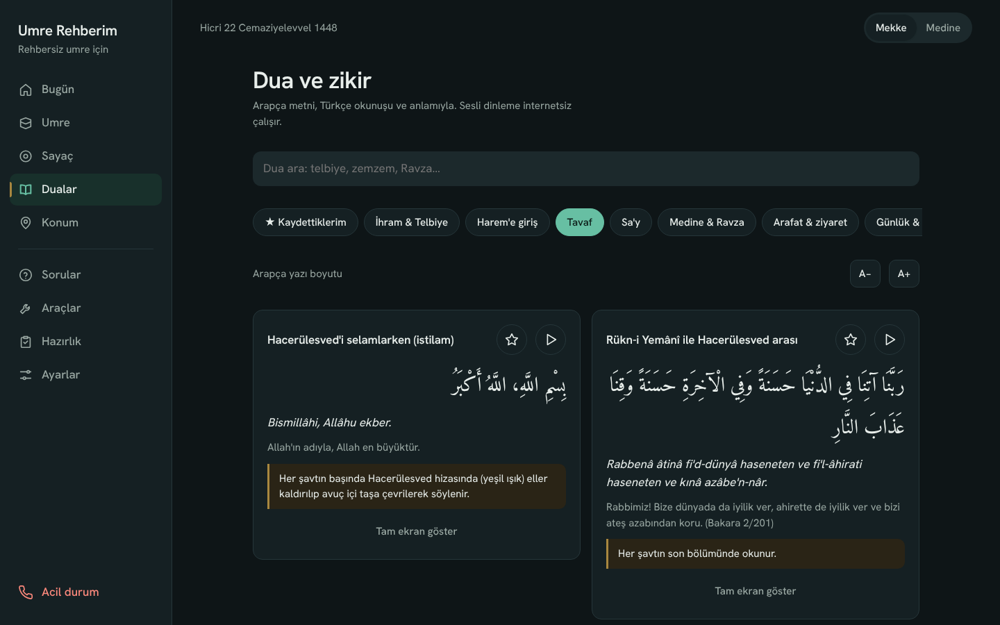

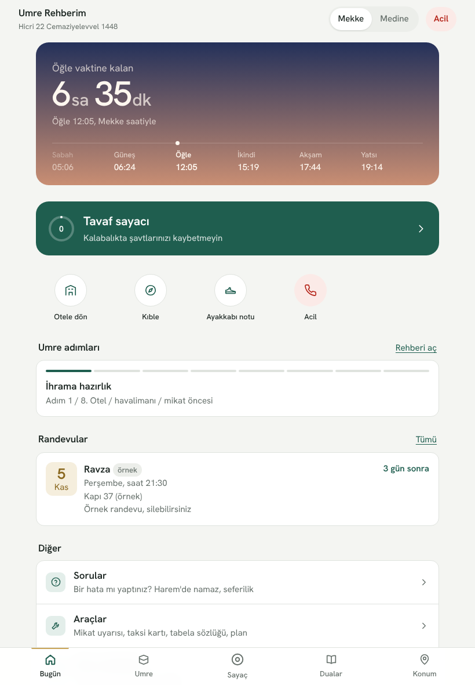

## Telefona kurulum

**Android:** [APK'yı indirin](https://umre-rehberim.pages.dev/umre-rehberim.apk) ve açın. "Bilinmeyen kaynaklardan yüklemeye izin ver" sorulursa izin verin. Daha önce 1.107'den eski bir sürüm kurduysanız önce onu kaldırın; sonraki sürümler eskisinin üzerine kurulur.

**iPhone:** Safari'de [umre-rehberim.pages.dev](https://umre-rehberim.pages.dev) adresini açın, Paylaş düğmesine dokunup "Ana Ekrana Ekle"yi seçin.

**Android'de tarayıcıdan:** Chrome'da adresi açın, menüden "Uygulamayı yükle" ya da "Ana ekrana ekle"yi seçin.

İlk açılıştan sonra uygulama internet olmadan da çalışır.

## Önemli not

Dini içerik, Diyanet İslam İlmihali ve Harameyn Genel Başkanlığı'nın umre rehberiyle karşılaştırılarak Hanefî mezhebine göre özetlenmiştir. Bir din görevlisinin değerlendirmesinin yerini tutmaz. Harem'deki kapı ve tesis konumları yaklaşıktır; uygulamadaki "Buradayım, düzelt" düğmesiyle sahada düzeltilebilir. Bir hata görürseniz [bildirin](https://github.com/zeybit/umre-rehberim-app/issues/new).

---

Umre Rehberim ücretsizdir, reklam içermez ve hesap açmanızı istemez. Kayıtlarınız yalnızca kendi cihazınızda saklanır.
